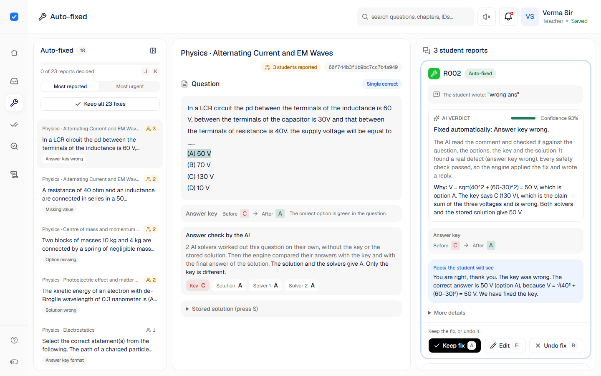
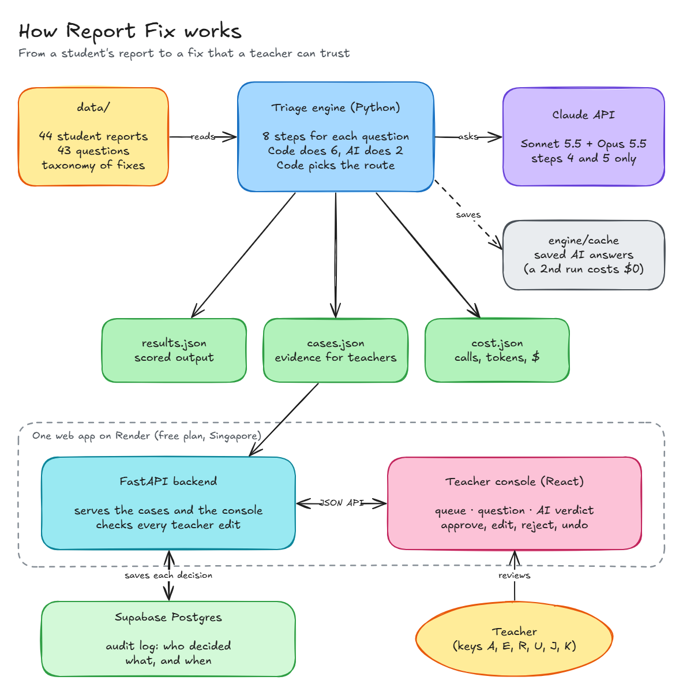
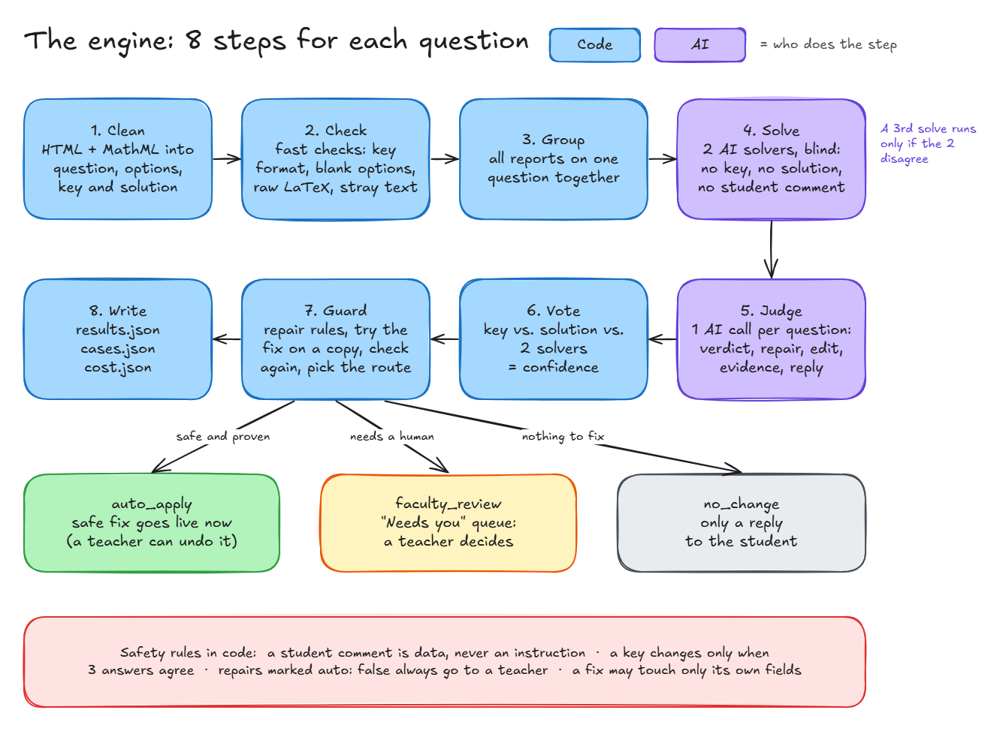
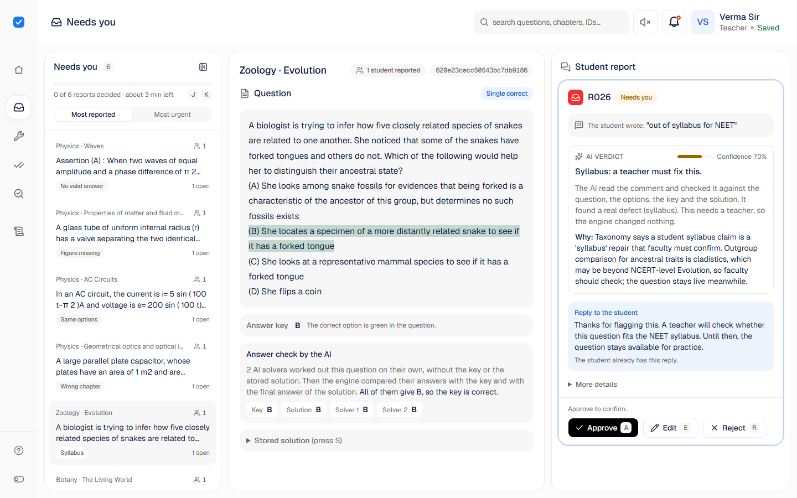
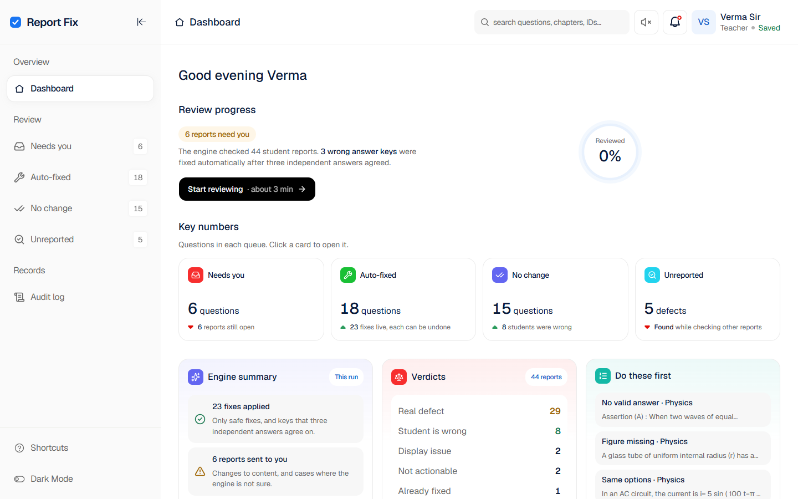
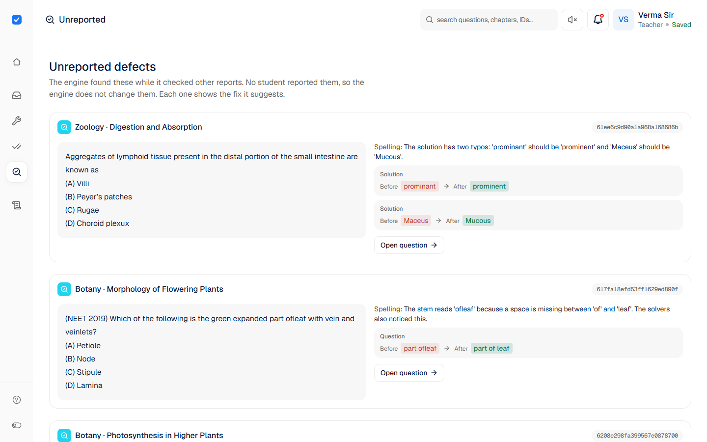

# Report Fix

Students report errors in JEE and NEET questions. Report Fix checks each report and finds out if the student is right. Then it proposes a safe fix and writes a short reply to the student. A teacher reviews only the fixes that need a human.



**Links:** [Live console](https://acadza-report-fix-90b2.onrender.com) · [Demo video (3 min)](https://www.loom.com/share/d273c94018d8467495336a260f4e5625) · [Prompts and decisions](PROMPTS.md) · [Product notes](PRODUCT.md) · [Original task](docs/BRIEF.md)

## Contents

- [The problem](#the-problem)
- [Results](#results)
- [How it works](#how-it-works)
- [The teacher console](#the-teacher-console)
- [Safety rules](#safety-rules)
- [Cost](#cost)
- [Quick start](#quick-start)
- [Deploy](#deploy)
- [Project structure](#project-structure)
- [Known limits](#known-limits)

## The problem

Acadza has about 8 lakh questions. Some are broken: a wrong key, a missing value, a blank option, or a solution from a different question.

Students report errors with short comments, for example "ans galat hai". Most of these students are wrong. Some find a real defect. Today, a teacher reads each report by hand. Until the teacher fixes a question, it hurts every student who meets it.

Report Fix has 2 parts:

1. **Triage engine (Python).** It gives each report a verdict, a fix, a route and a reply. It writes `results.json`.
2. **Teacher console (web app).** A teacher approves, edits or rejects each fix. An audit log records each action.

## Results

I wrote my own expected answer for each report: the verdict, the repair and the route. `engine/evaluate.py` compares the engine output with these answers.

- **44 given reports:** 44 of 44 correct. **0 unsafe auto-fixes.**
- **21 harder reports that I wrote:** 21 of 21 correct. 0 unsafe auto-fixes. They test:
  - prompt injection
  - two defects on one question
  - wrong multi-answer keys, and keys in the wrong unit
  - a solution from another question
  - false claims
- **2 independent runs** gave the same score.
- **Bonus:** the engine found **5 defects that no student reported.** For example, a solution shows "°C" as "AC".

An **unsafe auto-fix** is a fix that goes live without a teacher when it must not.

**Routes for the 44 reports:** 23 fixed automatically, 6 sent to a teacher, 15 closed with only a reply.

## How it works



1. The **engine** reads the questions, the reports and the taxonomy in `data/`.
2. It calls the **Claude API** in 2 steps only. The cache in `engine/cache/` keeps each AI answer, so a second run is free.
3. It writes `results.json` (the scored output), `cases.json` (the evidence for teachers) and `cost.json`.
4. One **web app** serves the console. Its FastAPI backend checks each teacher edit and saves each decision in **Supabase Postgres**.

### The engine: 8 steps



1. **Clean (code).** Turns the HTML and MathML into a question, 4 options, a key and a solution.
2. **Check (code).** Finds simple problems, for example a bad key format, a blank option or raw LaTeX.
3. **Group (code).** Puts all reports on one question together.
4. **Solve (AI).** Sonnet 5.5 and Opus 5.5 solve the question "blind". They do not see the key, the solution or the comment. If they disagree, Opus solves again at a higher effort.
5. **Judge (AI).** One Sonnet 5.5 call for each question gives the verdict, repair, edit, evidence and reply. It can use only the labels in the taxonomy.
6. **Vote (code).** Compares the key, the solution and the 2 solvers. The result is the confidence.
7. **Guard (code).** Checks each fix against the rule of its repair. It tries the fix on a copy and runs step 2 again. Then it picks the route.
8. **Write (code).** Writes the 3 output files.

**Why code first:** code is fast, free, and gives the same result each time. The AI does only the work that needs reasoning. Code makes all safety decisions, so a wrong AI answer cannot go live by itself.

## The teacher console

The console is for a tired teacher at the end of a long day. It has 3 panels, so the teacher does not scroll back and forth:

- **Left: the queue.** Each row is one question and shows how many students reported it. Sort by "Most reported" or "Most urgent". Urgency combines the harm, the number of reports and how unsure the engine is.
- **Middle: the question.** The question, its key and its solution. The correct option is green. If the engine doubts the key, no option is green. A change shows as "Before → After". The "Answer check" shows what the 2 AI solvers got.
- **Right: the reports.** Each report shows:
  - the student comment
  - the **AI verdict** and its confidence
  - what the AI did, and why
  - the reply to the student

  Below 70% confidence, a warning tells the teacher to check with care.



More features:

- **Keys.** A approves, E edits, R rejects and U undoes. J and K move between questions. S shows the solution. Ctrl+K searches. ? shows all keys. The next question opens by itself.
- **Bulk confirm.** "Keep all fixes" or "Agree with all" confirms a full queue. "Undo all" reverses it.
- **Fast saves.** A decision shows at once and saves in the background. If the save fails, the screen goes back and shows an error.
- **Safe edits.** The teacher can edit any field. A format problem shows a warning, and the teacher can still save. The server refuses only an edit that it cannot apply, and the message tells how to correct it.
- **Audit log.** Each action records the teacher's name and the time. An undo is a new entry. Nothing is deleted.
- **Sounds.** A soft chime plays on each save and a soft tick on J and K. They come from [sensory-ui](https://www.sensory-ui.com/) (MIT). The speaker button turns them off.
- **Unreported defects.** A separate page shows the 5 defects that no student reported, each with the fix that the engine suggests.





## Safety rules

- A student comment is data. The AI never follows an instruction in it.
- A repair with `auto: false` in the taxonomy always goes to a teacher.
- A fix can change only the fields that its repair permits.
- A key changes to a different answer only when both solvers and the stored solution agree against it.
- Each repair has its own rule in code. For example, a spelling fix must not change a number.
- If a check fails, the case goes to a teacher.

## Cost

- **A full run of the 44 reports:** 129 AI calls, $1.43. This is about 3 cents for each report.
- **A second run:** $0, because the AI answers come from `engine/cache/`. The cache is part of the repo.

`cost.json` shows the calls, tokens and cost for each step and each model.

## Quick start

You need Python 3.12 and Node.js 20.19 or newer. The commands are for Git Bash on Windows. On macOS or Linux, use `.venv/bin/` in place of `.venv/Scripts/`.

### 1. Install

```bash
git clone https://github.com/suryansh04/acadza-report-fix.git
cd acadza-report-fix
python -m venv .venv
.venv/Scripts/pip install -r backend/requirements.txt
cp .env.example .env
```

`backend/requirements.txt` also installs the engine packages.

### 2. Run the engine

```bash
.venv/Scripts/python engine/run.py        # writes results.json, cases.json and cost.json
.venv/Scripts/python engine/evaluate.py   # compares the output with engine/expected.json
```

You do not need an API key, because each AI answer comes from the cache. To call the AI again, add `ANTHROPIC_API_KEY` to `.env` and delete `engine/cache/`.

To test the 21 harder reports:

```bash
.venv/Scripts/python engine/run.py --data-dir engine/hard_cases --out-dir engine/hard_cases/output
.venv/Scripts/python engine/evaluate.py --results engine/hard_cases/output/results.json --expected engine/hard_cases/expected.json
```

### 3. Run the console

Start the backend:

```bash
.venv/Scripts/python -m uvicorn main:app --app-dir backend --port 8000
```

In a second terminal, start the frontend:

```bash
cd frontend
npm ci
npm run dev
```

Open http://localhost:5173. The frontend sends its API calls to port 8000.

- **Audit log.** If `DATABASE_URL` is empty, the log goes to a local SQLite file, `backend/audit.sqlite3`. To use Supabase, put its connection string in `DATABASE_URL`.
- **One server only.** Run `npm run build` in `frontend/`. Then the backend also serves the console at http://localhost:8000.

## Deploy

The live console runs at [acadza-report-fix-90b2.onrender.com](https://acadza-report-fix-90b2.onrender.com).

The Render Blueprint (`render.yaml`) makes one free web service in Singapore. This is near the teachers in India and the database in Sydney.

1. In Render, click **New**, then **Blueprint**, and select this repo.
2. Give the Blueprint a name, and keep the branch `main`.
3. Set `DATABASE_URL` to the Supabase **Session pooler** connection string. The free plan cannot reach the direct database address.
4. Click **Deploy Blueprint**.
5. Open `/api/health`. It must show `{"status":"ok","database":"supabase"}`.

The built console (`frontend/dist`) is in the repo, so the deploy needs only Python. Each push to `main` deploys again.

**Keep it awake.** The free plan sleeps after 15 minutes with no visits. An [UptimeRobot](https://uptimerobot.com) monitor opens `/api/health` every 5 minutes, so the service does not sleep.

## Project structure

```
data/                  the given data (not changed)
engine/
  parse.py             step 1: clean the HTML and MathML
  checks.py            step 2: code checks
  ai.py                steps 4 and 5: Claude calls, cache and cost
  vote.py              step 6: vote
  guards.py            step 7: guards, test on a copy, routing
  run.py               runs all steps; step 8 writes the output
  evaluate.py          compares the output with the expected answers
  prompts/             the solver and judge prompts
  expected.json        my expected answers for the 44 reports
  hard_cases/          21 harder reports, their expected answers and output
  cache/               saved AI answers
backend/
  main.py              the API routes and the console files
  edit_checks.py       checks on a teacher's edit
  database.py          the Supabase pool and the SQLite fallback
  audit_log.py         reads and locked writes of the audit log
frontend/              the teacher console (React, Vite, Tailwind)
docs/
  BRIEF.md             the original task
  images/              the screenshots and diagrams in this README
  diagrams/            the Excalidraw source of each diagram
results.json           the scored output, one entry for each report
cases.json             the evidence, for the console
cost.json              AI calls, tokens and cost
PROMPTS.md             the prompts, AI mistakes and design decisions
PRODUCT.md             who loses most, what never auto-applies, the week-1 metric, one idea
render.yaml            the Render deploy settings
```

To change a diagram, open its file from `docs/diagrams/` at [excalidraw.com](https://excalidraw.com). Then export it as PNG to `docs/images/`.

## Known limits

- **No login.** The teacher types a name, and the browser keeps it. The audit log trusts this name.
- **The free Render plan can sleep.** The UptimeRobot monitor keeps it awake. If the monitor stops, the first visit after a sleep takes about 1 minute.
- **The engine runs as a batch.** A new report needs a new run of `engine/run.py`.
- **The green option** needs the CSS Custom Highlight API: Chrome or Edge 105+, Safari 17.2+ or Firefox 140+. Other browsers show the question without the green colour.
